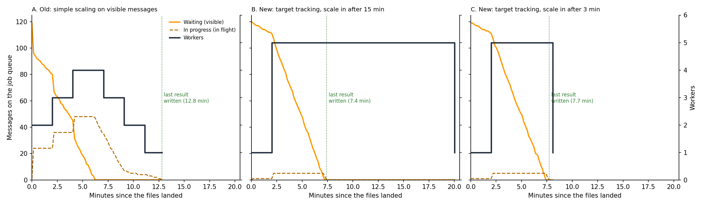

<div align="center">

# Auto-Scaling Document Pipeline on AWS

**An event-driven pipeline (S3 → SQS → EC2 workers → DynamoDB) that adds and removes workers based on queue backlog. Deployed on AWS, and re-runnable on a laptop with Docker.**


</div>

## Key results

- **On AWS:** 120 text files dropped into S3 at once. CloudWatch alarms on the queue backlog scaled the EC2 Auto Scaling group **from 1 to 5 instances and back to 1**, one instance at a time, with every result written to DynamoDB.
- **Instance type:** the run took about **10 minutes on t2.micro** and about **9 on t3.micro**. The job is I/O-bound, so a faster CPU barely helps; more workers do.
- **Self-healing:** during testing, AWS replaced an instance that failed its health check without any action from me ([screenshot](#2-what-happened-on-aws)).
- **Local re-run:** the same policy, re-created with Docker, processed 120 files in **12 min 16 s**, scaling **1 → 4 → 1**. It also exposed a flaw in the scale-in rule: workers were removed while 45 jobs were still in progress ([section 4](#4-fixing-scale-in-and-failure-handling)).
- **Fix, measured locally (23 Oct 2026):** scaling on backlog per instance (waiting + in-progress messages) and letting workers finish their job before stopping cut the 120-file run from **12 min 40 s to 7 min 24 s** (p95 latency 567 s → 428 s, 9.5 → 16.2 documents/min), with **0 jobs abandoned** by removed workers, against 13 under the old rule on the same machine.
- **Failure handling, measured locally:** with a dead-letter queue (3 attempts), 11 injected worker crashes and 4 poison messages, all **120 good documents were recorded exactly once**, each crashed job was retried, and the 4 poison messages landed in the dead-letter queue after 3 attempts each.
- **Estimated cost:** about **$0.09-0.10 per 1,000 documents** on t2.micro in us-east-1 when idle workers are removed within 3 minutes, and $0.24 when scale-in waits 15 minutes, from the measured instance-hours and AWS list prices ([section 4.4](#44-estimated-cost-per-1000-documents)). An estimate from the simulation, not an AWS bill.

## Contents

1. [Architecture and design decisions](#1-architecture-and-design-decisions)
2. [What happened on AWS](#2-what-happened-on-aws)
3. [Local re-run](#3-local-re-run)
4. [Fixing scale-in and failure handling](#4-fixing-scale-in-and-failure-handling)
5. [What I'd still change](#5-what-id-still-change)
6. [Run it yourself](#6-run-it-yourself)
7. [Credits and licence](#7-credits-and-licence)

## 1. Architecture and design decisions

A file landing in the processing bucket fires an S3 event, which puts one job message on SQS. Each worker, a Go service running under systemd on EC2, pulls a message, downloads the file, counts its ten most frequent words, writes them to DynamoDB, and reports to a result queue. Nothing calls the workers directly, so the number of workers can change at any time without losing jobs.

[](https://gitdiagram.com/ishaan-bhalla/aws-autoscaling-pipeline?utm_source=readme&utm_medium=picture)

*Architecture diagram (GitDiagram; click to explore it interactively).*

| Decision | Choice | Why |
|---|---|---|
| Scaling metric | Queue backlog (`ApproximateNumberOfMessagesVisible`), not CPU | The work is mostly waiting on S3 and DynamoDB, so CPU stays low even when the queue is full. Backlog measures the work that is actually waiting. |
| Scale out | Add 1 instance when backlog ≥ 10 for one 60 s period | Ten waiting files is several minutes of work for one worker |
| Scale in | Remove 1 instance when backlog = 0 for one 60 s period | Stop paying for idle workers once nothing is waiting (but see [section 4](#4-fixing-scale-in-and-failure-handling)) |
| Group size | Min 1, desired 1, max 5 | One worker always ready; a hard cost ceiling |
| Cooldown | 120 s after every scaling action | A new instance needs time to boot and start pulling work before the next decision; prevents flapping |
| Message visibility | 200 s, extended while a file is still being counted | A crashed or terminated worker's job reappears for another worker instead of being lost |
| Instance launch | Launch template from an AMI with the worker pre-installed as a systemd service | New instances start working on boot with no manual step |
| Instance type | t2.micro, then t3.micro for comparison | Cheapest types; the comparison showed the job is I/O-bound |

## 2. What happened on AWS

The deployment ran in a temporary AWS sandbox account (since closed) in December 2025. Account details and resource IDs are blurred in every screenshot.

<table>
<tr>
<td width="50%"><br><sub><b>Scaling policies.</b> Simple scaling: add 1 instance at backlog ≥ 10, remove 1 at backlog 0, then wait 120 s.</sub></td>
<td width="50%"><br><sub><b>CloudWatch alarms</b> on the job queue, evaluated every 60 s. Here the queue has drained, so the scale-in alarm is firing.</sub></td>
</tr>
<tr>
<td><br><sub><b>Scaling out.</b> New t2.micro workers launched by the group while the queue was full.</sub></td>
<td><br><sub><b>Scaling in.</b> The group stepping down 5 → 4 → 3 → 2 → 1, one instance every ~3 minutes. The top row shows AWS replacing an unhealthy instance automatically.</sub></td>
</tr>
<tr>
<td><br><sub><b>Auto Scaling group:</b> min 1, max 5, launched from the worker's launch template.</sub></td>
<td><br><sub><b>After the run:</b> job queue empty, one result message per processed file.</sub></td>
</tr>
</table>

| Run (120 files) | Start | End | Time |
|---|---|---|---|
| t2.micro workers | 20:30 | 20:40 | about 10 min |
| t3.micro workers | 20:57 | 21:06 | about 9 min |

## 3. Local re-run

The sandbox account is gone, so `local/` re-creates the system on a laptop to make the behaviour reproducible:

- **[Moto](https://github.com/getmoto/moto)** emulates S3, SQS and DynamoDB in one container, including the S3-to-SQS event notification, so the trigger works exactly as on AWS.
- **The worker is the same Go code**, built into a container. One container stands in for one t2.micro (one job at a time).
- **`local/scripts/autoscale.py`** re-creates the Auto Scaling policy with the same thresholds, limits, 60 s evaluation and 120 s cooldown, adding and removing worker containers.
- **The data** is 12 public-domain books from Project Gutenberg, split into 120 files, because the files used on AWS can't be redistributed.

**Result:** 120 files in 12 min 16 s, scaling 1 → 4 → 1 (chart at the top). The local run peaked at 4 workers, not 5 as on AWS. Each worker pulls about a dozen messages ahead and hides them from the queue, so the visible backlog fell below 10 sooner than CloudWatch saw it fall on AWS. Containers also start in seconds rather than the minute or two an EC2 instance takes to boot. The full log is in [`results/local_run.csv`](results/local_run.csv).

## 4. Fixing scale-in and failure handling

After the course I fixed the two weaknesses the local re-run exposed and measured the result on the same laptop on 23 October 2026. Every number below comes from [`results/2026-10-23/`](results/2026-10-23/) (samples every 10 s, every DynamoDB item, worker logs and a summary per run). These are local measurements: Moto stands in for AWS, a container stands in for an instance, and each job includes the starter code's simulated 10-20 s of processing.

### 4.1 What changed

- **Scaling policy** (`local/scripts/autoscale.py --policy target`): target tracking on *backlog per instance* = (visible + in-flight messages) / running instances, with a target of 10. Desired capacity is `ceil(backlog / 10)`, between 1 and 5. It scales out after 3 consecutive one-minute readings above target and can add several instances at once. Scale-in waits for 15 readings below target (run B), the delay AWS's managed target-tracking alarms are reported to use, or 3 readings (run C), which would need step scaling with your own alarms on AWS.
- **Worker** (`WORKER_HARDENED=1`, off by default so the binary still behaves as it did on AWS):
  - it receives a message only when it is free to start it. The original pulled about a dozen messages ahead, so one removed worker took a dozen jobs with it;
  - on SIGTERM it stops receiving, finishes the job in hand and exits. The original exited straight away;
  - results are written with a conditional put (`attribute_not_exists(Filename) OR ETag <> :etag`), so a redelivered message cannot write the same file twice;
  - messages it cannot parse are left for the dead-letter queue instead of being deleted.
- **Queue**: a dead-letter queue with `maxReceiveCount` 3 and a 60 s visibility timeout. A job takes at most about 20 s, and the worker extends the timeout for long files, so 60 s means a crashed job is retried within a minute instead of 200 s.

### 4.2 Old policy against new (120 files, same machine, same day)



| | A. Old policy, original worker | B. Target tracking, hardened worker | C. As B, scale in after 3 min |
|---|---|---|---|
| Processing time (first job queued → last result written) | 12 min 40 s | **7 min 24 s** | 7 min 37 s |
| Back to 1 instance | 12 min 48 s | 20 min 1 s | **8 min 4 s** |
| Peak instances | 4 | 5 | 5 |
| Latency per document, p50 / p95 (queued → written to DynamoDB) | 323 s / 567 s | **279 s / 428 s** | 281 s / 440 s |
| Throughput | 9.5 docs/min | **16.2 docs/min** | 15.8 docs/min |
| Jobs abandoned by removed workers | **13** (9 documents, 4 of them twice) | **0** | **0** |
| Documents that needed a second or third delivery | 9 | 0 | 0 |
| Instance-hours | 0.57 | 1.53 | **0.54** |
| Documents recorded / missing / duplicated | 120 / 0 / 0 | 120 / 0 / 0 | 120 / 0 / 0 |

- **The scale-in bug is fixed.** Under the old rule the first worker was removed at minute 7 with 35 jobs in flight on the queue. It held 9 of them, which sat hidden for the 200 s visibility timeout before another worker could take them, and 4 of those were abandoned again by the next removal. Under the new rule every removal happened with 0 jobs in flight.
- **Faster, because it scales out further and sooner.** Simple scaling adds one instance every 2 minutes. Target tracking went from 1 to 5 instances in one step at minute 2.
- **Slow scale-in costs money.** B kept 5 idle instances for about 12 minutes after the queue emptied, almost three times the instance-hours of A. C removes them after 3 minutes and used the fewest instance-hours of the three. Scaling in quickly is only safe because the worker now finishes its job before it stops.
- **Shutdown checked directly.** In all three runs the queue was empty by the time workers were removed, so `local/drain_test.sh` stops a worker in the middle of a job. The original worker exited at once and left its message hidden on the queue. The hardened worker took 11 s, finished, wrote the result and deleted the message ([`sigterm_drain_test.txt`](results/2026-10-23/sigterm_drain_test.txt)).
- The re-run of the old policy took 12 min 48 s in total (against 12 min 16 s before) and peaked at 4 workers again; timings move by tens of seconds between runs on a shared laptop.

### 4.3 Failure handling (run D)

Run D used the run C configuration and added failures to the same 120 files: 3 corrupt files (200 KB with no whitespace, which the word scanner rejects every time), 1 job message that is not an S3 event, and injected crashes. On a file's first delivery, about 1 file in 10 kills the worker: half of them after counting but before the DynamoDB write, half after the write but before the message is deleted. Docker restarts a crashed container, as the Auto Scaling group replaces an unhealthy instance.

| Check | Result |
|---|---|
| Good documents recorded | **120 of 120**, none missing, no extra items |
| Recorded word counts | all match an independent recount of each file |
| Injected crashes | 11 (5 before the write, 6 after it); **all 11 files recorded on a retry** |
| Crashes after the write | the retry's write was rejected by the conditional put 6 times out of 6; the result was written once |
| Poison messages | 3 corrupt files + 1 malformed message, each **tried 3 times, then moved to the dead-letter queue** |
| Processing time / p95 latency | 8 min 1 s / 456 s (against 7 min 37 s / 440 s in run C without failures) |

**Idempotency.** Each file has one DynamoDB item, keyed by its name, and the counts depend only on the file, so the table could never hold two copies of a document even before this change. A redelivered message simply overwrote the same item with the same result. The conditional put makes the second write a no-op instead of an overwrite. It also keeps the pipeline safe if a later step ever adds to running totals, because a total updated by a retried job would be counted twice. Including the ETag means a genuinely new version of a file under the same name is still recorded.

### 4.4 Estimated cost per 1,000 documents

This is an **estimate from the local simulation, not an AWS bill.** It takes the instance-seconds each run measured (from the files landing until the group was back to 1 instance) and AWS's public on-demand prices for **us-east-1**, read from AWS's price files on **23 October 2026** ([`prices_us-east-1.json`](results/2026-10-23/prices_us-east-1.json); pages: [EC2](https://aws.amazon.com/ec2/pricing/on-demand/), [VPC public IPv4](https://aws.amazon.com/vpc/pricing/), [EBS](https://aws.amazon.com/ebs/pricing/), [SQS](https://aws.amazon.com/sqs/pricing/), [DynamoDB](https://aws.amazon.com/dynamodb/pricing/on-demand/), [S3](https://aws.amazon.com/s3/pricing/)). It ignores the free tier.

| Prices used (us-east-1) | |
|---|---|
| t2.micro / t3.micro, Linux | $0.0116 / $0.0104 per hour |
| Public IPv4 address | $0.005 per hour per instance |
| EBS gp3 (8 GB root volume assumed) | $0.08 per GB-month |
| SQS standard | $0.40 per million requests |
| DynamoDB on-demand writes | $0.625 per million write request units |
| S3 Standard | $0.005 per 1,000 PUT/COPY, $0.0004 per 1,000 GET |

| Per 1,000 documents (t2.micro) | A. Old | B. Target, 15 min scale-in | C. Target, 3 min scale-in | D. C with failures |
|---|---|---|---|---|
| EC2 | $0.055 | $0.148 | $0.052 | $0.058 |
| Public IPv4 | $0.024 | $0.064 | $0.022 | $0.025 |
| EBS | $0.004 | $0.011 | $0.004 | $0.004 |
| S3 + SQS + DynamoDB requests | $0.014 | $0.016 | $0.014 | $0.014 |
| **Total** | **$0.097** | **$0.240** | **$0.092** | **$0.101** |

On t3.micro the totals are $0.091, $0.224, $0.087 and $0.095. Instance time is about 85% of the cost, so the scale-in delay matters far more than request charges, and the public IPv4 charge adds about 40% to the EC2 line. Request counts come from the design: 1 upload, 1 copy and 1 GET in S3 per document; 4 SQS requests per attempt plus, as an upper bound, one empty long poll every 5 s per running worker; 1 DynamoDB write per attempt. Real instances take a minute or two to boot (containers start in seconds), and the 10-20 s of simulated processing is not real work, so real instance-hours would differ. CloudWatch alarms and storage are left out because they are monthly charges, not per document.

## 5. What I'd still change

- **Carry the fixes to AWS.** Section 4 is measured locally only. On AWS, backlog per instance would be a CloudWatch metric-math expression over `ApproximateNumberOfMessagesVisible` and `ApproximateNumberOfMessagesNotVisible`. A termination lifecycle hook, or scale-in protection while a job is running, would give each worker time to finish its job, as the SIGTERM handler does locally.
- **Spread across Availability Zones and use a private subnet,** so one zone failing doesn't stop processing and the workers aren't exposed to the internet.
- **Protect the data:** S3 versioning and lifecycle rules for the files, and point-in-time recovery on the DynamoDB table.
- **Consider Lambda instead of EC2 for bursty loads like this.** Short, independent jobs fit Lambda's per-invocation scaling, with no instances to boot or leave idle. EC2 still makes sense for long-running or heavy jobs.

## 6. Run it yourself

Needs Docker and Python 3.10+. No AWS account is required.

```bash
git clone https://github.com/ishaan-bhalla/aws-autoscaling-pipeline.git
cd aws-autoscaling-pipeline
python3 -m venv .venv && source .venv/bin/activate
pip install -r requirements.txt
./local/run.sh        # about 12 minutes; writes results/local_run.csv and docs/local_scaling_run.png
```

To repeat the section 4 runs (each writes its files to `results/<date>/`):

```bash
POLICY=simple ./local/experiment.sh A-simple-policy-original-worker                                   # ~13 min
POLICY=target HARDENED=1 VISIBILITY=60 DLQ=3 ./local/experiment.sh B-target-tracking-hardened-worker  # ~20 min
POLICY=target IN_EVALS=3 HARDENED=1 VISIBILITY=60 DLQ=3 ./local/experiment.sh C-target-tracking-fast-scale-in
POLICY=target IN_EVALS=3 HARDENED=1 VISIBILITY=60 DLQ=3 CRASH_EVERY=20 POISON=3 MALFORMED=1 \
  ./local/experiment.sh D-failure-injection
./local/drain_test.sh                                   # stop a worker mid-job, original vs hardened
python local/scripts/cost_estimate.py results/<date>    # needs prices_us-east-1.json in that folder
```

The containers are capped at 2 CPUs for Moto and 1 per worker, so a run doesn't take over the machine.

To deploy on real AWS instead, `aws/` holds the EC2 setup scripts and the systemd unit used on the instances. Create the buckets, queues, table, launch template, Auto Scaling group and alarms with the settings in [section 1](#1-architecture-and-design-decisions), and don't set `AWS_ENDPOINT_URL`.

## 7. Credits and licence

The Go word-frequency worker in `app/` is based on the AWS sample [aws-go-wordfreq-sample](https://github.com/aws-samples/aws-go-wordfreq-sample) (Apache License 2.0), and the EC2 setup scripts in `aws/` came with the starter code. The architecture, AWS configuration, scaling design, load tests, local re-creation and this write-up are my own. See [NOTICE](NOTICE) for exactly what changed. Licensed under the Apache License 2.0.
