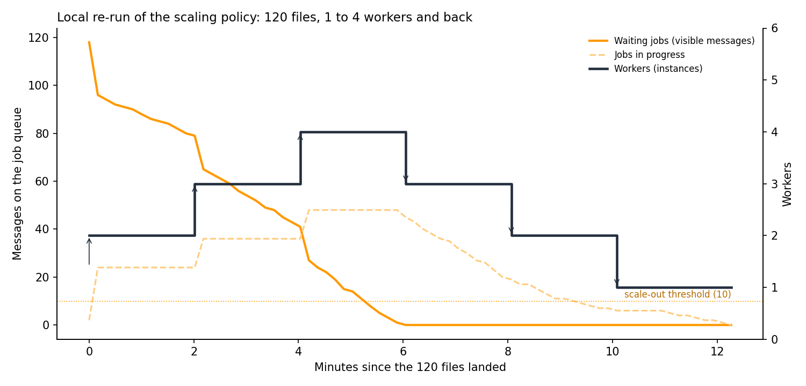
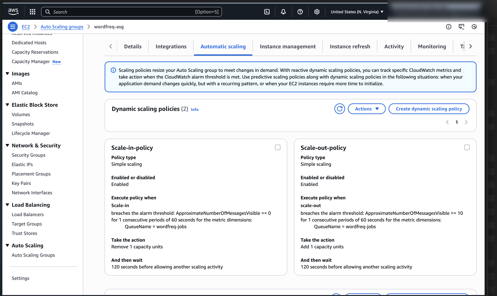
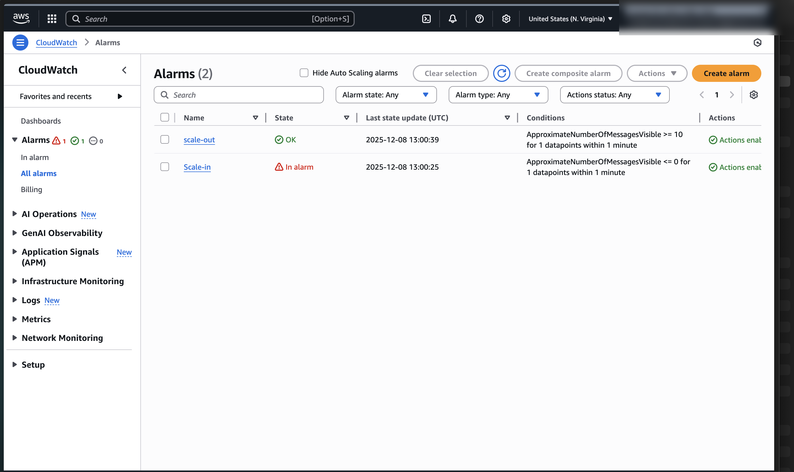
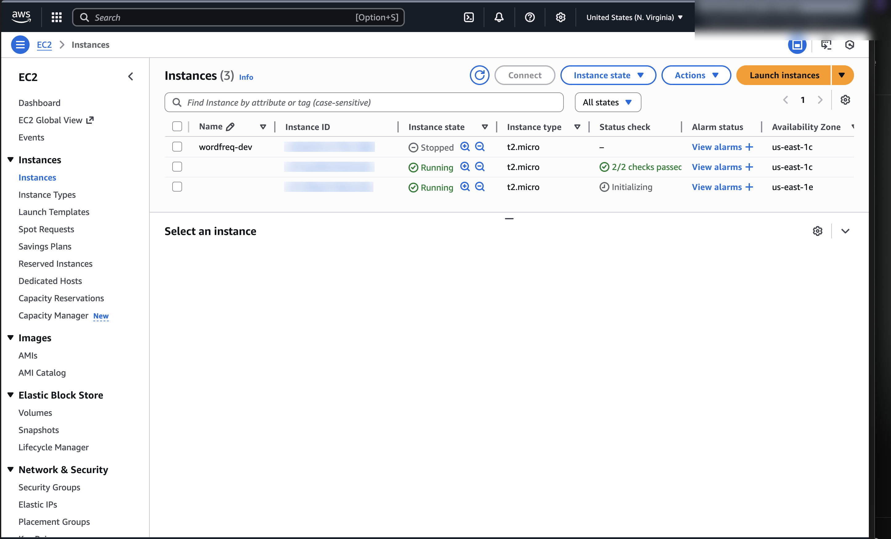
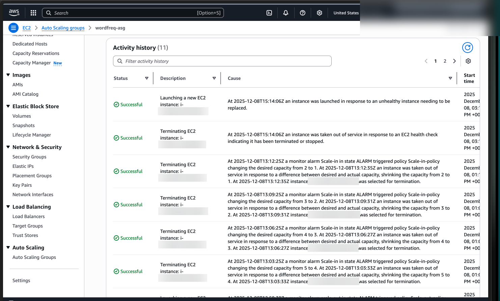
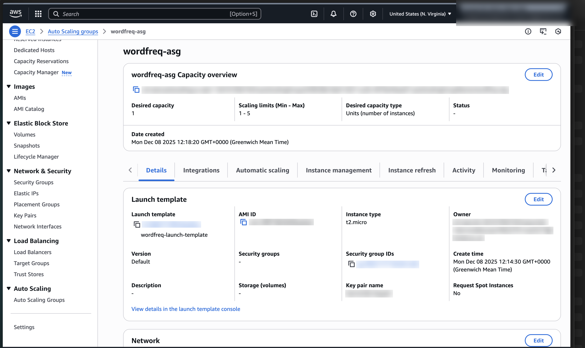
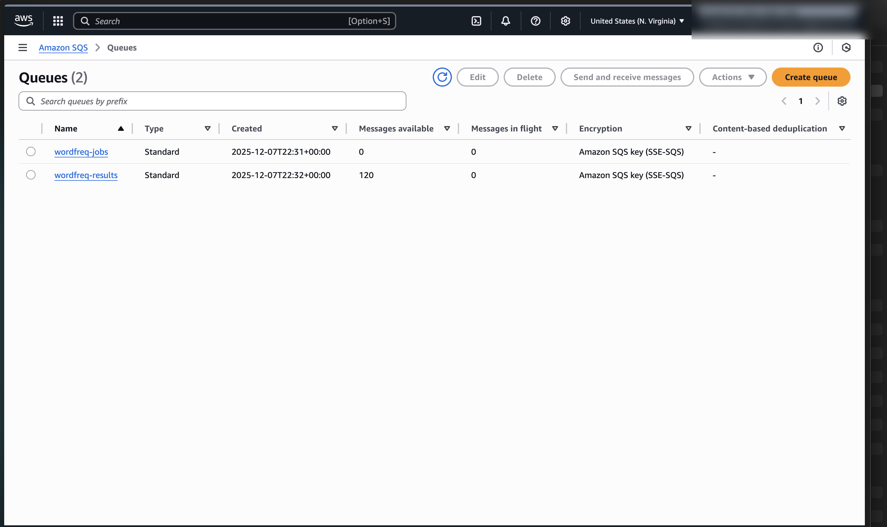

<div align="center">

# Auto-Scaling Document Pipeline on AWS

**An event-driven pipeline (S3 → SQS → EC2 workers → DynamoDB) that adds and removes workers based on queue backlog. Deployed on AWS, and re-runnable on a laptop with Docker.**




</div>

## Key results

- **On AWS:** 120 text files dropped into S3 at once. CloudWatch alarms on the queue backlog scaled the EC2 Auto Scaling group **from 1 to 5 instances and back to 1**, one instance at a time, with every result written to DynamoDB.
- **Instance type:** the run took about **10 minutes on t2.micro** and about **9 on t3.micro**. The job is I/O-bound, so a faster CPU barely helps; more workers do.
- **Self-healing:** during testing, AWS replaced an instance that failed its health check without any action from me ([screenshot](#2-what-happened-on-aws)).
- **Local re-run:** the same policy, re-created with Docker, processed 120 files in **12 min 16 s**, scaling **1 → 4 → 1**. It also exposed a flaw in the scale-in rule: workers were removed while 45 jobs were still in progress ([section 4](#4-what-id-change)).

## Contents

1. [Architecture and design decisions](#1-architecture-and-design-decisions)
2. [What happened on AWS](#2-what-happened-on-aws)
3. [Local re-run](#3-local-re-run)
4. [What I'd change](#4-what-id-change)
5. [Run it yourself](#5-run-it-yourself)
6. [Credits and licence](#6-credits-and-licence)

## 1. Architecture and design decisions

A file landing in the processing bucket fires an S3 event, which puts one job message on SQS. Each worker, a Go service running under systemd on EC2, pulls a message, downloads the file, counts its ten most frequent words, writes them to DynamoDB, and reports to a result queue. Nothing calls the workers directly, so the number of workers can change at any time without losing jobs.

[](https://gitdiagram.com/ishaan-bhalla/aws-autoscaling-pipeline?utm_source=readme&utm_medium=picture)

*Architecture diagram (GitDiagram; click to explore it interactively).*

| Decision | Choice | Why |
|---|---|---|
| Scaling metric | Queue backlog (`ApproximateNumberOfMessagesVisible`), not CPU | The work is mostly waiting on S3 and DynamoDB, so CPU stays low even when the queue is full. Backlog measures the work that is actually waiting. |
| Scale out | Add 1 instance when backlog ≥ 10 for one 60 s period | Ten waiting files is several minutes of work for one worker |
| Scale in | Remove 1 instance when backlog = 0 for one 60 s period | Stop paying for idle workers once nothing is waiting (but see [section 4](#4-what-id-change)) |
| Group size | Min 1, desired 1, max 5 | One worker always ready; a hard cost ceiling |
| Cooldown | 120 s after every scaling action | A new instance needs time to boot and start pulling work before the next decision; prevents flapping |
| Message visibility | 200 s, extended while a file is still being counted | A crashed or terminated worker's job reappears for another worker instead of being lost |
| Instance launch | Launch template from an AMI with the worker pre-installed as a systemd service | New instances start working on boot with no manual step |
| Instance type | t2.micro, then t3.micro for comparison | Cheapest types; the comparison showed the job is I/O-bound |

## 2. What happened on AWS

The deployment ran in a temporary AWS sandbox account (since closed) in December 2025. Account details and resource IDs are blurred in every screenshot.

<table>
<tr>
<td width="50%"><br><sub><b>Scaling policies.</b> Simple scaling: add 1 instance at backlog ≥ 10, remove 1 at backlog 0, then wait 120 s.</sub></td>
<td width="50%"><br><sub><b>CloudWatch alarms</b> on the job queue, evaluated every 60 s. Here the queue has drained, so the scale-in alarm is firing.</sub></td>
</tr>
<tr>
<td><br><sub><b>Scaling out.</b> New t2.micro workers launched by the group while the queue was full.</sub></td>
<td><br><sub><b>Scaling in.</b> The group stepping down 5 → 4 → 3 → 2 → 1, one instance every ~3 minutes. The top row shows AWS replacing an unhealthy instance automatically.</sub></td>
</tr>
<tr>
<td><br><sub><b>Auto Scaling group:</b> min 1, max 5, launched from the worker's launch template.</sub></td>
<td><br><sub><b>After the run:</b> job queue empty, one result message per processed file.</sub></td>
</tr>
</table>

| Run (120 files) | Start | End | Time |
|---|---|---|---|
| t2.micro workers | 20:30 | 20:40 | about 10 min |
| t3.micro workers | 20:57 | 21:06 | about 9 min |

## 3. Local re-run

The sandbox account is gone, so `local/` re-creates the system on a laptop to make the behaviour reproducible:

- **[Moto](https://github.com/getmoto/moto)** emulates S3, SQS and DynamoDB in one container, including the S3-to-SQS event notification, so the trigger works exactly as on AWS.
- **The worker is the same Go code**, built into a container. One container stands in for one t2.micro (one job at a time).
- **`local/scripts/autoscale.py`** re-creates the Auto Scaling policy with the same thresholds, limits, 60 s evaluation and 120 s cooldown, adding and removing worker containers.
- **The data** is 12 public-domain books from Project Gutenberg, split into 120 files, because the files used on AWS can't be redistributed.

**Result:** 120 files in 12 min 16 s, scaling 1 → 4 → 1 (chart at the top). The local run peaked at 4 workers, not 5 as on AWS. Each worker pulls about a dozen messages ahead and hides them from the queue, so the visible backlog fell below 10 sooner than CloudWatch saw it fall on AWS. Containers also start in seconds rather than the minute or two an EC2 instance takes to boot. The full log is in [`results/local_run.csv`](results/local_run.csv).

## 4. What I'd change

- **Scale in on total work, not waiting work.** The scale-in rule fires when no messages are *waiting*, even if many are still *in progress*. Locally, workers started being removed at minute 6 with 45 jobs in flight, and the last stretch took another 6 minutes on fewer workers. A better signal is visible + in-flight messages per instance, using a target-tracking policy (for example, aim for 10 messages per worker). Workers should also finish their current job before they're terminated (a lifecycle hook or a SIGTERM handler).
- **Spread across Availability Zones and use a private subnet,** so one zone failing doesn't stop processing and the workers aren't exposed to the internet.
- **Protect the data:** S3 versioning and lifecycle rules for the files, and point-in-time recovery on the DynamoDB table.
- **Consider Lambda instead of EC2 for bursty loads like this.** Short, independent jobs fit Lambda's per-invocation scaling, with no instances to boot or leave idle. EC2 still makes sense for long-running or heavy jobs.

## 5. Run it yourself

Needs Docker and Python 3.10+. No AWS account is required.

```bash
git clone https://github.com/ishaan-bhalla/aws-autoscaling-pipeline.git
cd aws-autoscaling-pipeline
python3 -m venv .venv && source .venv/bin/activate
pip install -r requirements.txt
./local/run.sh        # about 12 minutes; writes results/local_run.csv and docs/local_scaling_run.png
```

To deploy on real AWS instead, `aws/` holds the EC2 setup scripts and the systemd unit used on the instances. Create the buckets, queues, table, launch template, Auto Scaling group and alarms with the settings in [section 1](#1-architecture-and-design-decisions), and don't set `AWS_ENDPOINT_URL`.

## 6. Credits and licence

The Go word-frequency worker in `app/` is based on the AWS sample [aws-go-wordfreq-sample](https://github.com/aws-samples/aws-go-wordfreq-sample) (Apache License 2.0), and the EC2 setup scripts in `aws/` came with the starter code. The architecture, AWS configuration, scaling design, load tests, local re-creation and this write-up are my own. See [NOTICE](NOTICE) for exactly what changed. Licensed under the Apache License 2.0.
